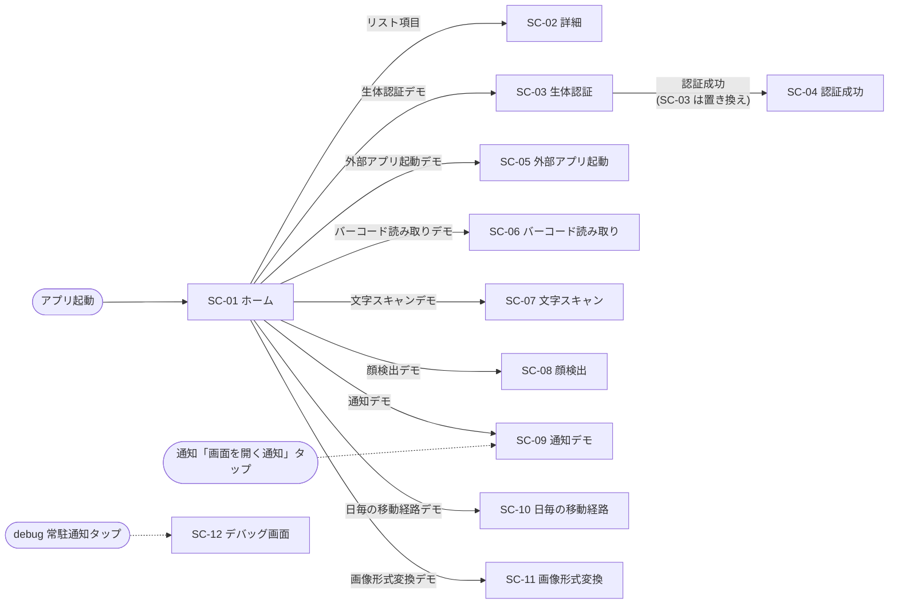

# 2. 画面設計

## 2.1 画面一覧

| 画面 ID | 画面名 | 機能 ID | 画面上の戻る操作 | ビルド |
| --- | --- | --- | --- | --- |
| SC-01 | ホーム | — | なし(起動画面) | 共通 |
| SC-02 | 詳細 | F-01 | 「Back」ボタン | 共通 |
| SC-03 | 生体認証 | F-02 | システムの戻る操作のみ | 共通 |
| SC-04 | 認証成功 | F-02 | 「ホームに戻る」ボタン | 共通 |
| SC-05 | 外部アプリ起動 | F-03 | システムの戻る操作のみ | 共通 |
| SC-06 | バーコード読み取り | F-04 | システムの戻る操作のみ | 共通 |
| SC-07 | 文字スキャン | F-05 | システムの戻る操作のみ | 共通 |
| SC-08 | 顔検出 | F-06 | システムの戻る操作のみ | 共通 |
| SC-09 | 通知デモ | F-07 | システムの戻る操作のみ | 共通 |
| SC-10 | 日毎の移動経路 | F-08 | 左上の戻るアイコン / 権限要求時は「戻る」ボタン | 共通 |
| SC-11 | 画像形式変換 | F-09 | システムの戻る操作のみ | 共通 |
| SC-12 | デバッグ画面 | F-10 | 左上の戻るアイコン | debug のみ |

全画面共通の仕様:

- 1 つの Activity 上で画面を切り替える(シングルアクティビティ)。
- システムの戻る操作(戻るボタン / ジェスチャー)で直前の画面に戻る。ホームで戻るとアプリを終了する。
- 画面内の遷移ボタンは画面がアクティブ(RESUMED)な間のみ受け付け、連打による多重遷移を防ぐ。
- 画面回転などの構成変更では、入力内容や表示状態を保持する。
- 各画面の状態は画面がバックスタック上にある間だけ保持され、戻る操作で画面を閉じると破棄される
  (同じ画面を再度開くと初期状態から始まる)。

## 2.2 画面遷移

### 通知からの遷移

| 起点 | 遷移先 | 仕様 |
| --- | --- | --- |
| 通知「画面を開く通知」のタップ | SC-09 | アプリ未起動時はホームの上に SC-09 を積んで起動する。起動中は現在の画面の上に SC-09 を積む。最前面がすでに SC-09 の場合は積まない |
| debug 常駐通知「デバッグメニュー」のタップ | SC-12 | 同上(最前面がすでに SC-12 の場合は積まない)。release ビルドでは発生しない |
| 位置情報記録中の通知のタップ | (遷移なし) | アプリを前面に表示するのみ。表示中の画面はそのまま |

### 生体認証の遷移

認証成功時は SC-03 をバックスタックから取り除いて SC-04 を表示する。
このため SC-04 で戻る操作をすると SC-03 ではなく SC-01 に戻る。

---

## 2.3 各画面の仕様

### SC-01 ホーム

| No. | 項目 | 種別 | 仕様 |
| --- | --- | --- | --- |
| 1 | 「生体認証デモ」 | ボタン | SC-03 へ遷移 |
| 2 | 「外部アプリ起動デモ」 | ボタン | SC-05 へ遷移 |
| 3 | 「バーコード読み取りデモ」 | ボタン | SC-06 へ遷移 |
| 4 | 「文字スキャンデモ」 | ボタン | SC-07 へ遷移 |
| 5 | 「顔検出デモ」 | ボタン | SC-08 へ遷移 |
| 6 | 「通知デモ」 | ボタン | SC-09 へ遷移 |
| 7 | 「日毎の移動経路デモ」 | ボタン | SC-10 へ遷移 |
| 8 | 「画像形式変換デモ」 | ボタン | SC-11 へ遷移 |
| 9 | 項目リスト | リスト(縦スクロール) | 「Item 1」〜「Item 20」の 20 件。タップで SC-02 へ遷移し、項目名を引数として渡す |

ボタン群は画面上部に固定表示し、その下の残り領域をリストがスクロールする。

**起動時の振る舞い(debug ビルドのみ)**: Android 13 以上で通知権限が未許可の場合、
初回表示時に通知権限ダイアログを表示する。許可・拒否にかかわらずデバッグ用常駐通知の
サービスを起動する([通知設計](03_notification-design.md) 参照)。同一プロセス内では画面回転などで再表示しない。

### SC-02 詳細

| No. | 項目 | 種別 | 仕様 |
| --- | --- | --- | --- |
| 1 | 「Detail: {項目名}」 | テキスト(見出し) | SC-01 で選択した項目名を表示(例:「Detail: Item 3」) |
| 2 | 「Back」 | ボタン | 前の画面に戻る |

### SC-03 生体認証

端末の生体認証の利用可否を判定し、状態に応じて表示を切り替える。
認証方式は **生体認証(Class 3 / Strong)のみ** とし、PIN・パターン・パスワードによる代替認証は許可しない。

| 端末の状態 | 表示テキスト | ボタン | ボタン押下時 |
| --- | --- | --- | --- |
| 利用可能 | 「端末に登録済みの生体情報で認証します」 | 「認証する」 | 生体認証ダイアログを表示 |
| 生体情報が未登録 | 「生体情報が未登録です。端末設定から登録してください」 | 「生体情報を登録する」 | OS の登録画面を開く。戻ってきたら利用可否を再判定して表示を更新 |
| ハードウェアなし | 「この端末は生体認証に対応していません」 | なし | — |
| ハードウェア利用不可 | 「生体認証ハードウェアが現在利用できません」 | なし | — |
| セキュリティ更新が必要 | 「セキュリティアップデートが必要です」 | なし | — |
| その他 | 「生体認証を利用できません(status={状態コード})」 | なし | — |

画面上部に見出し「生体認証デモ」を常に表示する。

**生体認証ダイアログ(OS 提供)**

| 項目 | 値 |
| --- | --- |
| タイトル | 「生体認証」 |
| サブタイトル | 「登録済みの生体情報で認証してください」 |
| ネガティブボタン | 「キャンセル」 |

**認証結果**

| 結果 | 振る舞い |
| --- | --- |
| 成功 | SC-04 へ遷移(SC-03 は置き換え) |
| 生体情報の不一致(再試行可能) | エラー色で「生体情報を認識できませんでした。もう一度お試しください」を表示。ダイアログは表示されたまま |
| キャンセル(「キャンセル」押下・ダイアログ外操作など) | エラー色で「認証がキャンセルされました」を表示 |
| その他のエラー(ロックアウトなど) | エラー色で「認証エラー({エラーコード}): {OS のエラーメッセージ}」を表示 |

### SC-04 認証成功

| No. | 項目 | 種別 | 仕様 |
| --- | --- | --- | --- |
| 1 | 「認証に成功しました」 | テキスト(見出し) | 固定文言 |
| 2 | 「認証日時: {日時}」 | テキスト | この画面を開いた日時を端末ロケールの日時形式(中程度の長さ)で表示。画面を開いている間は変化しない |
| 3 | 「ホームに戻る」 | ボタン | 前の画面(SC-01)に戻る |

### SC-05 外部アプリ起動

| No. | 項目 | 種別 | 仕様 |
| --- | --- | --- | --- |
| 1 | 「外部アプリ起動デモ」 | テキスト(見出し) | 固定文言 |
| 2 | 「タイトル(1行)」 | テキスト入力(1 行) | 改行は入力できない。貼り付けで混入した改行も除去する |
| 3 | 「本文」 | テキスト入力(複数行、最小 5 行) | 改行可 |
| 4 | 「メールアプリを起動」 | ボタン | メール作成アプリを起動。件名 = タイトル、本文 = 本文 |
| 5 | 「メッセージアプリを起動」 | ボタン | SMS アプリを起動。本文 = タイトルと本文を改行で連結(空の項目は除く) |
| 6 | 「ファイルとして保存」 | ボタン | OS のファイル保存画面を開く。既定ファイル名は「{タイトル}.txt」(タイトルが空白のみなら「untitled.txt」) |
| 7 | 「共有アプリを選択」 | ボタン | OS の共有シート(タイトル「共有」)を開く |
| 8 | メッセージ | テキスト | 操作結果を表示(下表) |

画面全体は縦スクロール可能で、ソフトウェアキーボード表示時は入力欄が隠れないよう余白を取る。
各ボタンの連携内容の詳細は [外部インターフェース設計 4.2](04_external-interface.md#42-他アプリ連携intent) を参照。

| 契機 | メッセージ |
| --- | --- |
| 対応するアプリが端末にない | 「対応するアプリが見つかりませんでした」 |
| 保存画面でキャンセル | 「保存がキャンセルされました」 |
| 保存成功 | 「ファイルに保存しました」 |
| 保存失敗 | 「保存に失敗しました: {エラー内容}」 |

保存ファイルの内容: 1 行目にタイトル、2 行目以降に本文(UTF-8、既存ファイルは上書き)。

### SC-06 / SC-07 / SC-08 カメラ系画面(共通仕様)

| 項目 | 仕様 |
| --- | --- |
| カメラ権限 | 画面を開いた時点で未許可なら権限ダイアログを自動表示する |
| 権限未許可時の表示 | 案内文(画面ごと、下表)と「カメラ権限を許可する」ボタン。ボタンで再度権限を要求する |
| 使用カメラ | 背面カメラ |
| プレビュー | 画面(または上部領域)いっぱいにカメラ映像を表示 |
| 検出結果の表示 | 検出対象の位置に緑の枠を重ねて表示し、映像に追従して更新する |
| 表示の保持 | 検出が一瞬途切れても表示がちらつかないよう、最後に検出してから一定時間(下表)は直前の結果を表示し続ける |
| カメラの停止 | 画面がバックグラウンドに移る、または画面を閉じるとカメラを停止する |

| 画面 | 権限未許可時の案内文 | 表示保持時間 |
| --- | --- | --- |
| SC-06 | 「バーコードの読み取りにはカメラ権限が必要です」 | 1 秒 |
| SC-07 | 「文字の読み取りにはカメラ権限が必要です」 | 1 秒 |
| SC-08 | 「顔検出にはカメラ権限が必要です」 | 0.5 秒 |

### SC-06 バーコード読み取り

| No. | 項目 | 仕様 |
| --- | --- | --- |
| 1 | カメラプレビュー | 全画面 |
| 2 | 検出枠 | バーコードごとに緑の枠。1 フレームに複数のバーコードがあればすべて表示 |
| 3 | 読み取り内容ラベル | 各枠の直下に、半透明の黒背景で読み取った内容を表示 |
| 4 | URL リンク | 内容が URL(バーコードの URL 種別、または http / https で始まる文字列)の場合、ラベルを青字・下線で表示し、タップでブラウザー等で開く。開けるアプリがない場合は何もしない |

対応フォーマット: ML Kit が対応する全フォーマット(QR コード、EAN-13、Code 128 など)。

### SC-07 文字スキャン

| No. | 項目 | 仕様 |
| --- | --- | --- |
| 1 | カメラプレビュー | 画面上部(パネルを除いた残り全体) |
| 2 | 検出枠 | 認識したテキストの行ごとに緑の枠 |
| 3 | 認識テキスト欄 | 画面下部パネル。認識したテキスト全体を表示(高さ 48〜120dp、超過分は欄内スクロール)。未認識時は「カメラを文字に向けてください」 |
| 4 | 「読み取った文字をコピー」 | 認識テキストをクリップボードへコピー。未認識時は無効 |

認識対象: ラテン文字のみ。

### SC-08 顔検出

| No. | 項目 | 仕様 |
| --- | --- | --- |
| 1 | カメラプレビュー | 画面上部(パネルを除いた残り全体) |
| 2 | 検出枠 | 顔ごとに緑の枠 |
| 3 | 顔情報ラベル | 枠の直下に半透明の黒背景で表示。取得できた項目のみ表示:「ID: {トラッキング ID}」「笑顔: {n}%」「左目: {n}% 右目: {n}%」(確率は 0〜100 の整数、小数点以下切り捨て) |
| 4 | 検出人数パネル | 画面下部。未検出時「カメラを顔に向けてください」、検出時「検出した顔: {人数}人」 |

トラッキング ID は同じ人物の顔がフレームをまたいで映り続ける間、同じ値になる。
検出は速度優先モードで行う。

### SC-09 通知デモ

| No. | 項目 | 種別 | 仕様 |
| --- | --- | --- | --- |
| 1 | 「通知デモ」 | テキスト(見出し) | 固定文言 |
| 2 | 権限案内 | テキスト | 通知権限が未許可の場合のみ「通知を表示するには通知権限が必要です。ボタンを押すと権限を要求します。」を表示 |
| 3 | 「1. メッセージ通知を表示」 | ボタン | 通知 NT-01 を表示 |
| 4 | 「2. タップで画面を開く通知を表示」 | ボタン | 通知 NT-02 を表示 |
| 5 | 「3. 選択肢付き通知を表示」 | ボタン | ステータスを「未対応」に戻したうえで通知 NT-03 を表示 |
| 6 | ステータスカード | カード | タイトル「選択肢付き通知のステータス」、現在のステータス(「未対応」「承認済み」「却下」)、説明文「通知の「承認」「却下」をタップすると、ここの表示が更新されます。」 |
| 7 | 「ステータスをリセット」 | ボタン | ステータスを「未対応」に戻す |

- 通知権限が未許可の状態で No.3〜5 を押した場合は、通知を出さずに権限ダイアログを表示する。
  許可後、改めてボタンを押すと通知が表示される。
- ステータスは通知の操作によって画面表示中にもリアルタイムで更新される。
- 通知の内容は [通知設計](03_notification-design.md) を参照。

### SC-10 日毎の移動経路

#### 権限未許可時

位置情報権限(詳細・おおよそのいずれか)が未許可の場合、地図の代わりに以下を表示する。
画面に戻ってくる(再表示される)たびに権限の状態を再確認する。

| No. | 項目 | 仕様 |
| --- | --- | --- |
| 1 | 「位置情報の権限が必要です」 | 見出し |
| 2 | 「経路を記録・表示するには位置情報の許可が必要です。」 | 説明文 |
| 3 | 「権限を許可する」 | 詳細な位置情報とおおよその位置情報の権限を同時に要求する。どちらか一方でも許可されれば地図表示に切り替える |
| 4 | 「戻る」 | 前の画面に戻る |

#### 権限許可時

| No. | 項目 | 配置 | 仕様 |
| --- | --- | --- | --- |
| 1 | 地図 | 全画面 | Google マップ。初期表示は東京駅中心・ズーム 14。現在地(青い点)と現在地ボタンを表示 |
| 2 | 経路線 | 地図上 | 選択日の記録地点を時刻順に結んだ青線(2 地点以上ある場合) |
| 3 | 「出発地点」マーカー | 地図上 | 選択日の最初の地点 |
| 4 | 「最終地点」マーカー | 地図上 | 選択日の最後の地点(2 地点以上ある場合) |
| 5 | 戻るアイコン | 左上 | 前の画面に戻る |
| 6 | 日付セレクター | 上部中央 | 下表参照 |
| 7 | 記録ボタン | 下部中央 | 下表参照 |

**表示範囲の自動調整**: 選択日の地点が 2 つ以上なら全地点が収まる範囲へ、1 つならその地点をズーム 16 で
中心に表示するよう、地図をアニメーションで移動する。0 件の場合は移動しない。

**日付セレクター**

| 要素 | 仕様 |
| --- | --- |
| 日付表示 | 選択中の日付(`yyyy-MM-dd`)。記録がなければ「データなし」 |
| 件数表示 | 「{選択日の地点数}地点 / {記録のある日数}日分」。記録がなければ「未記録」 |
| 「前の日」(←) | 1 つ古い記録日へ移動。最も古い日を表示中は無効 |
| 「次の日」(→) | 1 つ新しい記録日へ移動。最も新しい日を表示中は無効 |

- 選択できる日付は記録が存在する日のみ。画面を開いた時点では最も新しい記録日を表示する。
- 記録中は新しい地点が追加されるたびに経路・件数表示が自動で更新される。
- 日付の区切りは端末のタイムゾーンでの暦日。

**記録ボタン**

| 状態 | 表示 | 色 | 押下時 |
| --- | --- | --- | --- |
| 停止中 | 「● 記録開始」 | プライマリ系 | Android 13 以上で通知権限が未許可なら通知権限を要求し、結果にかかわらず記録を開始する。それ以外は即座に記録を開始する |
| 記録中 | 「■ 記録停止」 | エラー系 | 記録を停止する |

- 記録は画面を閉じても、アプリをバックグラウンドにしても継続する(記録中通知 NT-04 を表示)。
- 記録を開始できなかった場合(OS によるフォアグラウンドサービス起動の拒否など)は停止中の表示のままとなる。
- 記録条件は [外部インターフェース設計 4.3](04_external-interface.md#43-os-機能端末機能の利用) を参照。

### SC-11 画像形式変換

| No. | 項目 | 種別 | 表示条件 | 仕様 |
| --- | --- | --- | --- | --- |
| 1 | 「画像を選択」 | ボタン | 常時(変換中は無効) | OS の写真選択ツール(画像のみ)を開く。選択をキャンセルした場合は何もしない |
| 2 | プレビュー | 画像 | 画像選択後 | 選択した画像を幅いっぱい・高さ最大 240dp で縦横比を保って表示 |
| 3 | 画像情報 | テキスト | 画像選択後 | 1 行目: ファイル名(取得できなければ「(名称不明)」)。2 行目:「{MIME タイプ または「形式不明」} / {幅}×{高さ}px」 |
| 4 | 「変換先の形式」 | 見出し | 画像選択後 | — |
| 5 | 形式の選択肢 | ラジオボタン | 画像選択後 | 下表の 6 形式。初期値は PNG。変換中、および端末が対応しない形式は無効 |
| 6 | 「変換して保存」 | ボタン | 画像選択後 | OS のファイル保存画面を開き、保存先が決まると変換・保存する。変換中はボタン内にスピナーを表示して無効化 |
| 7 | 結果メッセージ | テキスト | 処理後 | 成功はプライマリ色、失敗はエラー色(下表) |

**形式の選択肢**

| 表示名 | 説明文 | 拡張子 | 選択可能条件 |
| --- | --- | --- | --- |
| PNG | 可逆圧縮・透過対応 | `.png` | 常時 |
| JPEG | 非可逆圧縮・写真向け(透過は白背景に合成) | `.jpg` | 常時 |
| WebP | 非可逆圧縮・高圧縮率・透過対応 | `.webp` | 常時 |
| GIF | 256色に減色されます(透過は白背景に合成) | `.gif` | 常時 |
| BMP | 無圧縮・ファイルサイズ大(透過は白背景に合成) | `.bmp` | 常時 |
| HEIC | 高効率圧縮(Android 9 以上) | `.heic` | Android 9 以上 |

**保存ファイル名の既定値**: 「{元のファイル名から拡張子を除いたもの}.{変換先の拡張子}」。
元のファイル名が取得できない場合は「converted_{yyyyMMdd_HHmmss}.{拡張子}」。

**メッセージ**

| 契機 | メッセージ |
| --- | --- |
| 保存成功 | 「{形式名} 形式で保存しました ({ファイルサイズ})」(サイズは B / KB / MB、小数 1 桁) |
| 画像の読み込み失敗 | 「画像の読み込みに失敗しました: {エラー内容}」 |
| 変換・保存の失敗 | 「変換に失敗しました: {エラー内容}」。保存画面で作成された空ファイルは削除する |

- 別の画像を選び直すと、前回の結果メッセージは消去される。短時間に連続して選び直した場合は最後に選んだ画像が表示される。
- 変換の品質・サイズ上限などの出力仕様は [データ設計 5.3](05_data-design.md#53-入出力ファイル) を参照。

### SC-12 デバッグ画面(debug ビルドのみ)

アプリ内に保存されているデータを、開発者が確認するための画面。表示専用で編集機能は持たない。

| No. | 項目 | 仕様 |
| --- | --- | --- |
| 1 | 戻るアイコン | 前の画面に戻る |
| 2 | 「デバッグ画面」 | 画面タイトル |
| 3 | 「再読み込み」 | データを読み直す。読み込み中はタイトル下に進捗バーを表示 |
| 4 | エラー表示 | データベースの読み込みに失敗した場合、エラー内容をエラー色で表示 |
| 5 | 常駐通知カード | 「常駐通知: 表示中 / 非表示」、説明「デバッグビルドのみ。通知をタップするとこの画面を開きます」、「常駐通知を再表示」ボタン(常駐通知を再開する) |
| 6 | DataStore セクション | 見出し「DataStore」。登録された DataStore ごとにカードを表示(ファイル名順) |
| 7 | Database セクション | 見出し「Database」と「{DB ファイル名} (version {スキーマバージョン})」。テーブルごとにカードを表示(テーブル名順) |

**DataStore カード**: ファイル名を見出しに、キーと値をキー名順に一覧表示する(値は等幅フォント)。
キー名が `_at` で終わるか `time` を含み、値が正の整数の場合は、エポックミリ秒とみなして
「yyyy/MM/dd HH:mm:ss」形式の日時を併記する。データがなければ「(空)」、読み込みエラー時はエラー内容を表示。
DataStore が 1 つもない場合は「登録された DataStore はありません」。

**テーブルカード**: 見出し「{テーブル名} ({総件数} 件)」。列名を 1 行目に、各行を「 | 」区切りの等幅フォントで表示し、
横にはみ出す場合はカード内で横スクロールする。表示は先頭 100 件までとし、超過時は「先頭 100 件のみ表示」と表示する。
NULL は「null」、BLOB は「<blob {n} bytes>」と表示する。行がなければ「(空)」、テーブルがなければ「テーブルがありません」。
SQLite / Room の管理用テーブルは表示しない。

## 参考(公式ドキュメント)

- [生体認証ダイアログを表示する](https://developer.android.com/identity/sign-in/biometric-auth)
- [Navigation 3 の基本](https://developer.android.com/guide/navigation/navigation-3/basics)
- [ML Kit バーコードスキャン(Android)](https://developers.google.com/ml-kit/vision/barcode-scanning/android)
- [ML Kit テキスト認識 v2(Android)](https://developers.google.com/ml-kit/vision/text-recognition/v2/android)
- [ML Kit 顔検出(Android)](https://developers.google.com/ml-kit/vision/face-detection/android)
- [Maps Compose ライブラリ](https://developers.google.com/maps/documentation/android-sdk/maps-compose)
- [写真選択ツール(Photo Picker)](https://developer.android.com/training/data-storage/shared/photo-picker)
