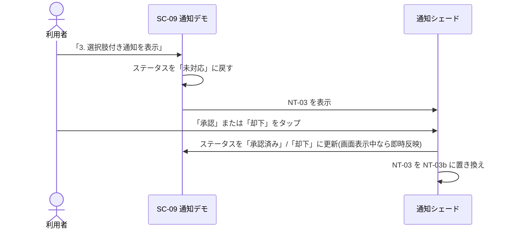

# 3. 通知設計

## 3.1 通知チャンネル

OS の通知設定画面に表示されるチャンネル。利用者はチャンネル単位で通知の ON/OFF や重要度を変更できる。

| チャンネル ID | 表示名 | 説明 | 重要度 | 作成タイミング | ビルド |
| --- | --- | --- | --- | --- | --- |
| `demo_messages` | デモ通知 | 通知機能デモ用のチャンネル | DEFAULT(音あり) | アプリ起動時 | 共通 |
| `location_tracking` | 位置情報記録 | — | LOW(音なし) | 経路記録の開始時 | 共通 |
| `debug_tools` | デバッグツール | デバッグビルドの常駐通知 | LOW(音なし・バッジなし) | 常駐通知サービスの開始時 | debug のみ |

## 3.2 通知一覧

| 通知 ID | 名称 | チャンネル | 通知番号 | 発生契機 | 消去方法 |
| --- | --- | --- | --- | --- | --- |
| NT-01 | メッセージ通知 | `demo_messages` | 1001 | SC-09「1. メッセージ通知を表示」 | タップ / スワイプ |
| NT-02 | 画面を開く通知 | `demo_messages` | 1002 | SC-09「2. タップで画面を開く通知を表示」 | タップ / スワイプ |
| NT-03 | 承認リクエスト通知 | `demo_messages` | 1003 | SC-09「3. 選択肢付き通知を表示」 | スワイプ(本文タップでは消えない) |
| NT-03b | 承認リクエスト結果通知 | `demo_messages` | 1003(NT-03 を置き換え) | NT-03 のアクション操作 | タップ / スワイプ |
| NT-04 | 経路記録中通知 | `location_tracking` | 2001 | SC-10 で記録開始 | 記録停止で消える(※1) |
| NT-05 | デバッグメニュー常駐通知 | `debug_tools` | 3001 | debug ビルドのアプリ起動時 / SC-12「常駐通知を再表示」 | 「停止」アクション(※1) |

同じ通知番号の通知を再度表示した場合は、既存の通知が新しい内容で置き換わる(重複表示しない)。

※1 常駐(ongoing)通知。Android 13 以下ではスワイプで消せない。Android 14 以上では OS の仕様により
スワイプで非表示にできるが、サービス(記録・常駐)は継続する。

## 3.3 通知の内容と操作

### NT-01 メッセージ通知

| 項目 | 内容 |
| --- | --- |
| タイトル | 「新着メッセージ」 |
| 本文 | 「これは普通のメッセージ通知です。」 |
| タップ時 | 通知を消去する(画面遷移なし) |

### NT-02 画面を開く通知

| 項目 | 内容 |
| --- | --- |
| タイトル | 「画面を開く通知」 |
| 本文 | 「タップすると通知デモ画面を開きます。」 |
| タップ時 | アプリを前面に表示して SC-09 を開き、通知を消去する([画面設計 2.2](02_screen-design.md#通知からの遷移)) |

### NT-03 承認リクエスト通知 / NT-03b 結果通知

| 項目 | NT-03 | NT-03b |
| --- | --- | --- |
| タイトル | 「承認リクエスト」 | 「承認リクエスト」 |
| 本文 | 「この依頼を承認しますか?」 | 「ステータスを「{承認済み / 却下}」に更新しました。」 |
| アクション | 「承認」「却下」 | なし |
| タップ時 | 何もしない(通知は残る) | 通知を消去する |

- アクション操作はアプリを前面に出さずに処理される。
- ステータスはアプリのプロセスが生きている間のみ保持する。プロセス終了後に NT-03 のアクションを
  操作した場合も、新しいプロセスでステータスが更新される。

### NT-04 経路記録中通知

| 項目 | 内容 |
| --- | --- |
| タイトル | 「経路を記録中」 |
| 本文 | 「位置情報を取得しています」 |
| アイコン | OS 標準の現在地アイコン |
| 常駐 | あり(※1) |
| タップ時 | アプリを前面に表示する(画面は遷移しない) |

位置情報のフォアグラウンドサービスに紐づく通知であり、記録停止(SC-10「■ 記録停止」)で消える。

### NT-05 デバッグメニュー常駐通知(debug ビルドのみ)

| 項目 | 内容 |
| --- | --- |
| タイトル | 「デバッグメニュー」 |
| 本文 | 「タップでデバッグ画面を開きます」 |
| アクション | 「停止」: 常駐通知(サービス)を終了する |
| 常駐 | あり(※1)。時刻表示なし |
| タップ時 | アプリを前面に表示して SC-12 を開く |

「停止」で終了した後は、アプリの再起動(プロセス再生成)または SC-12「常駐通知を再表示」で再表示できる。

## 3.4 通知権限(Android 13 以上)

Android 13(API 33)以上では `POST_NOTIFICATIONS` の実行時権限がないと通知は表示されない。

| 場面 | 権限未許可時の振る舞い |
| --- | --- |
| SC-09 の各ボタン | 通知を出さずに権限ダイアログを表示する |
| SC-10 の記録開始 | 権限ダイアログを表示し、許可・拒否にかかわらず記録は開始する(拒否時は NT-04 が通知シェードに表示されない場合がある) |
| debug ビルドの起動時 | 権限ダイアログを表示し、許可・拒否にかかわらず常駐通知サービスを起動する |
| NT-03 のアクション操作後(権限が取り消された場合) | ステータスは更新されるが NT-03b は表示されない |

Android 12 以下では権限要求を行わず、常に通知を表示する。

## 参考(公式ドキュメント)

- [通知チャンネルの作成と管理](https://developer.android.com/develop/ui/views/notifications/channels)
- [通知の実行時の権限](https://developer.android.com/develop/ui/views/notifications/notification-permission)
- [通知にアクションボタンを追加する](https://developer.android.com/develop/ui/views/notifications/build-notification#Actions)
- [Android 14 の動作変更: 閉じることのできない通知の扱い](https://developer.android.com/about/versions/14/behavior-changes-all#non-dismissable-notifications)
- [フォアグラウンド サービスの通知](https://developer.android.com/develop/background-work/services/fgs/launch)
